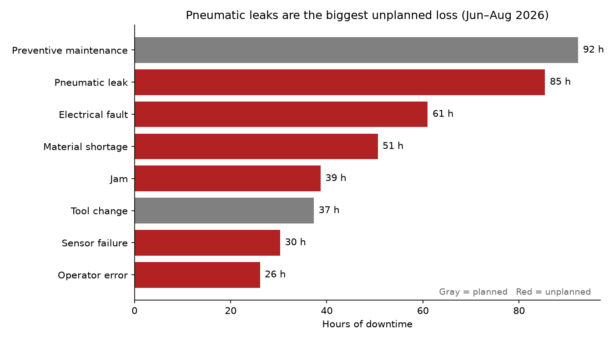
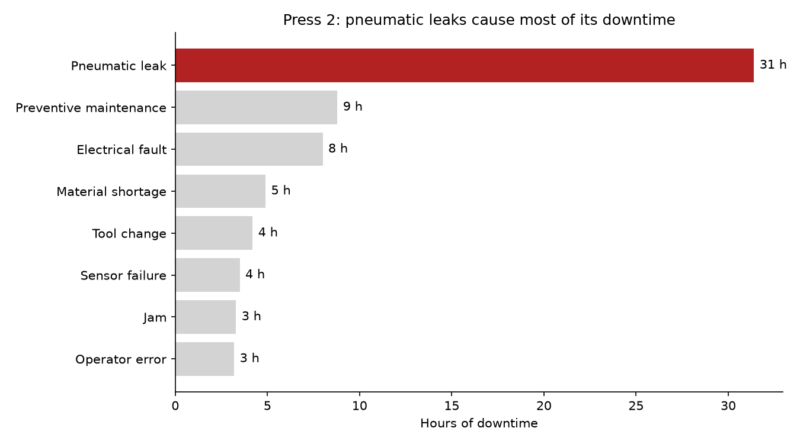
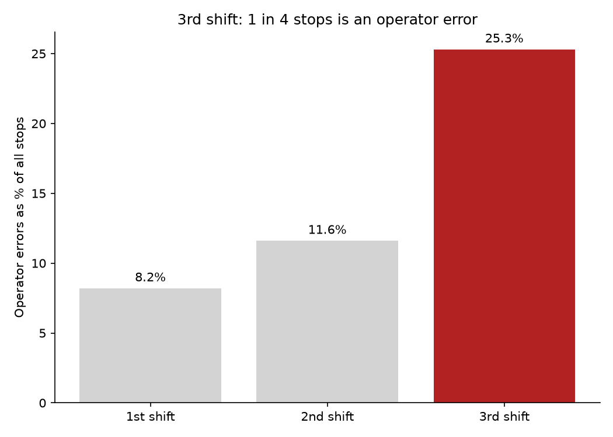

# Machine Downtime Analysis

Analysis of three months of machine downtime at a manufacturing plant, answering the plant manager's question: **where are we losing the most production time, and why?**

**Tools:** SQL (SQLite), Python, pandas, matplotlib, Jupyter

> The dataset is simulated (621 downtime events across 8 machines, June–August 2026), modeled on real plant-floor downtime patterns.

## Bottom line

Reducing pneumatic leaks with special attention to Press 2, and looking into 3rd shift errors would recover the most downtime for the plant.

## Findings

### 1. Pneumatic leaks are the largest source of unplanned downtime

They cost about 85 hours over three months, more than any other breakdown cause, and Press 2 accounts for over a third of that.

**Recommendation:** Inspect Press 2's air lines, fittings, and seals, and add a leak check to its preventive maintenance routine.

### 2. 3rd shift has an operator-error problem

3rd shift's operator error rate is more than 2 times that of 2nd shift and 3 times that of 1st shift. 3rd shift is the night shift and it may be that the operators are tired because of the time of day. Other possibilities include shift lead supervision issues, inadequate training, experience, or number of workers.

**Recommendation:** Walk the floor with 3rd shift leads to observe and report findings.

### 3. Jams happen most often but cost the least time per event

Jams are the most frequent interruptions: 151 total events at a 15-minute average duration, for a total of nearly 39 hours. The Packager accounts for 46 events, about double the rate of any other machine.

**Recommendation:** Observe machine jams for possible solutions. Operator interviews regarding the jams may lead to more insight.

## Note on the data

This data does not take into consideration the production volume per shift.

## Methods

- Loaded the downtime log into a SQLite database and analyzed it with SQL (`GROUP BY`, aggregate functions, `CASE WHEN` for rate calculations).
- Compared shifts by **error rate** rather than raw counts, since shifts have different numbers of total events.
- Separated **planned** downtime (preventive maintenance, tool changes) from **unplanned** breakdowns.
- Built charts in matplotlib, with titles that state each finding.

## Files

| File | What it is |
|---|---|
| `downtime_analysis.ipynb` | Part 1: exploring the data with SQL |
| `downtime_part2.ipynb` | Part 2: charts and findings |
| `downtime_log.csv` | The downtime data |
| `chart*.png` | Chart images used above |

## How to run

1. Install the libraries: `pip install pandas matplotlib notebook`
2. Put all files in one folder and open the notebooks with `jupyter notebook`
3. Run the cells top to bottom
